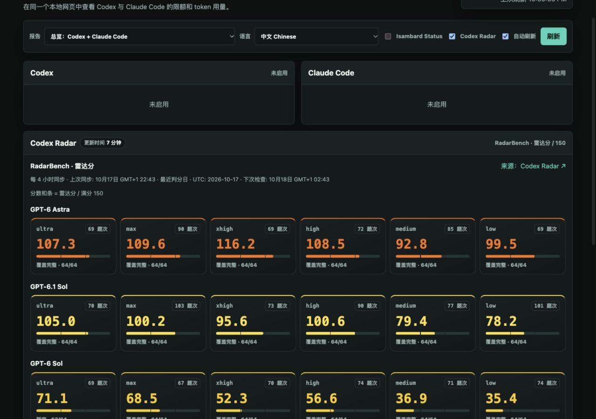
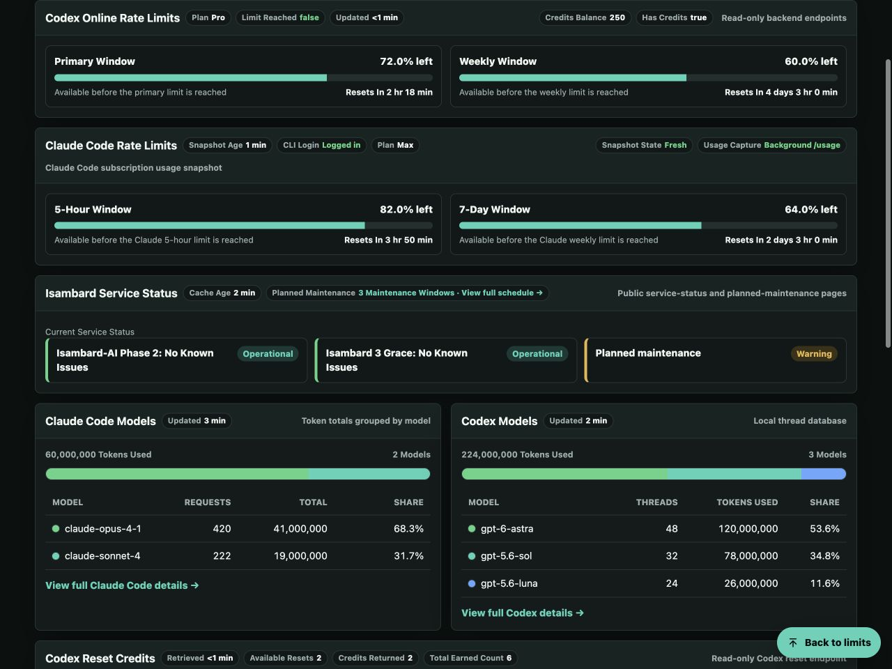
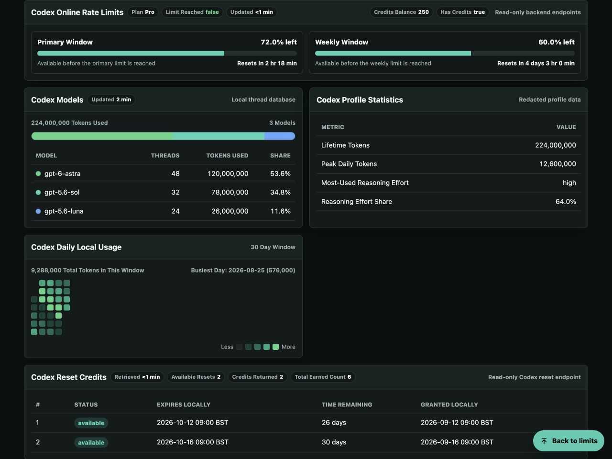
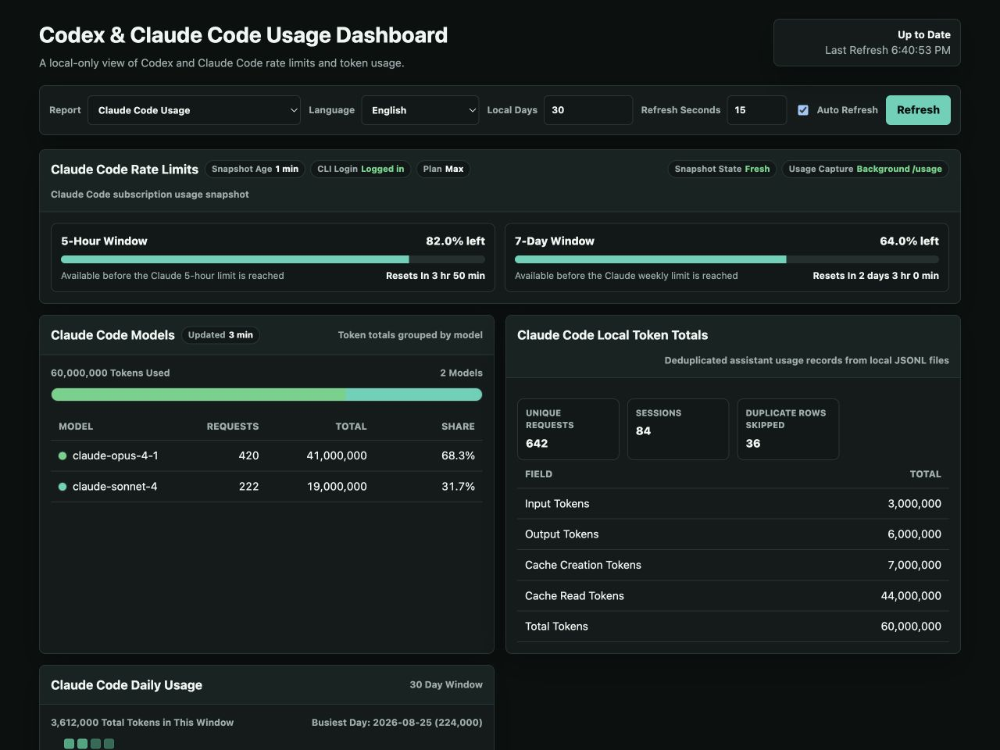
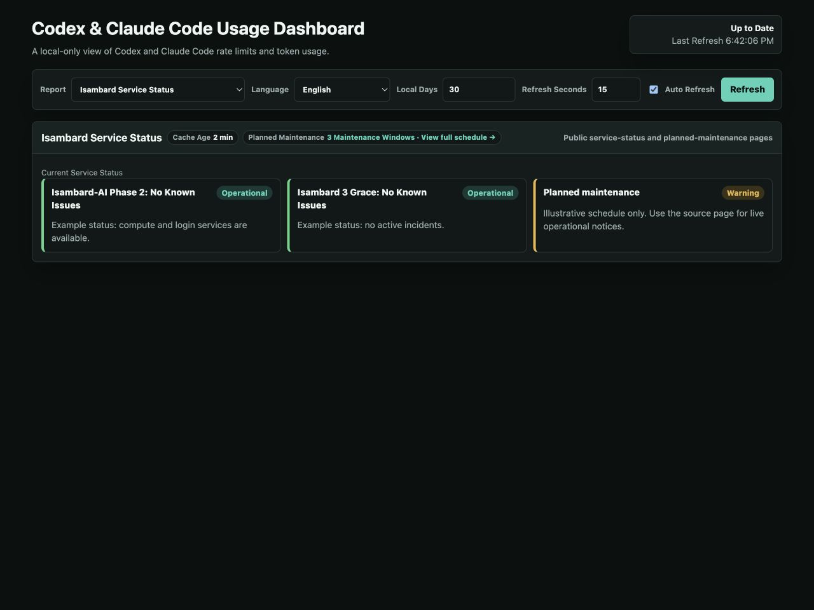
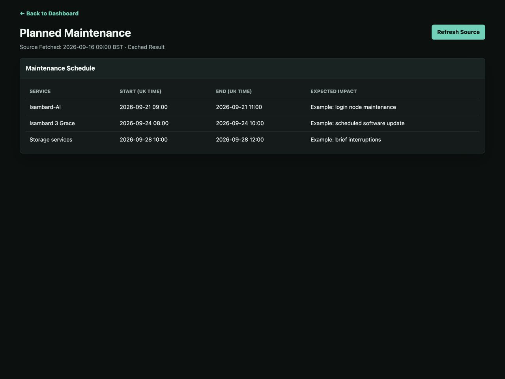
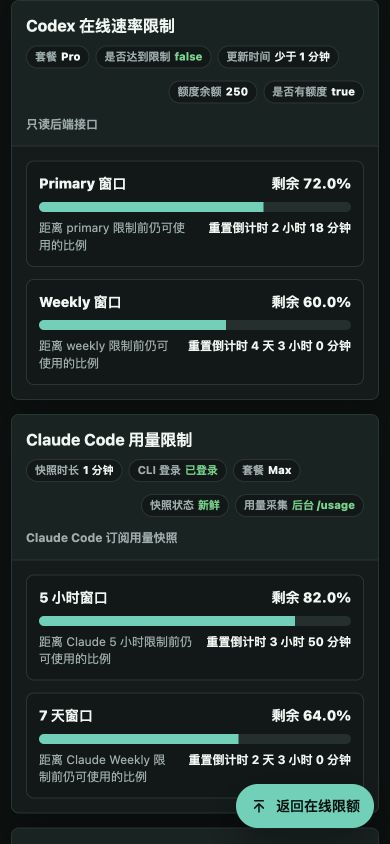
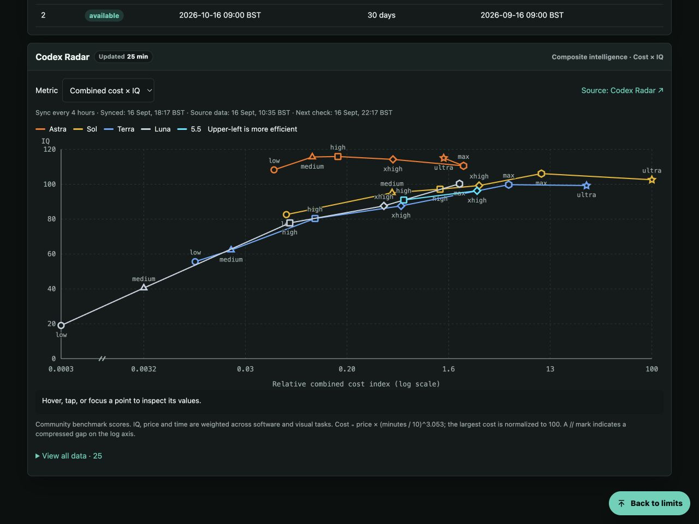
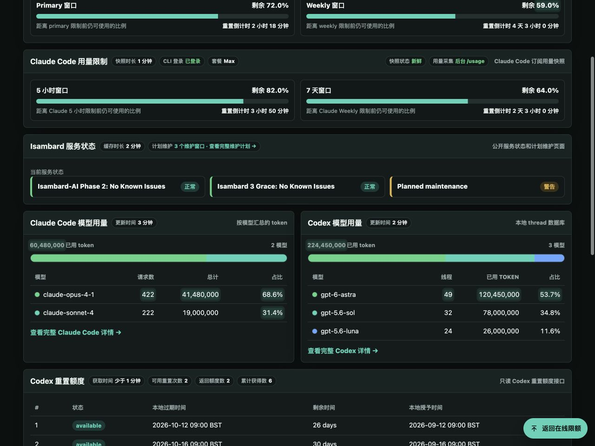

# Screenshots

[Quick start](../README.md)

## Current Radar score cards

Captured on **2026-10-17** from the dashboard using a public RadarBench snapshot.
Only Radar was enabled for this preview; Codex and Claude account data are absent.
The score and thin bar share a fixed maximum of 150. These are example benchmark
values from that date, not live scores or official model ratings.

See [Radar behaviour](radar.md) / [中文说明](radar.zh-CN.md) for scoring and refresh rules.

## Earlier dashboard gallery

The thumbnails below were captured on **2026-09-16** with illustrative usage,
project and service-status data. They document earlier layouts and may differ
from the current toolbar. Image 7 shows the retired IQ chart; the current Radar
layout is shown above. They are feature examples, not live account usage,
official ratings or current service-status reports. Click a thumbnail for full size.

<!-- markdownlint-disable MD033 -- HTML keeps the screenshot gallery compact on GitHub. -->

  
  
  
  
  
  
  
  

<!-- markdownlint-enable MD033 -->

Images 1–5: overview, Codex detail, Claude Code detail, Isambard status, and
maintenance. Image 6: mobile layout. Image 7: retired IQ curves. Image 8: model-value
change highlights (one frame of the animation).
